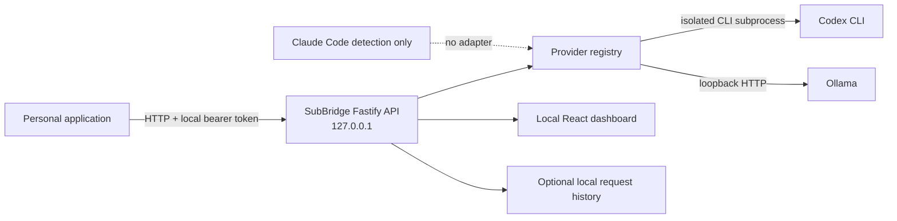

# SubBridge

## Your AI tools. One local API.

SubBridge is an open-source, self-hosted gateway that connects supported AI command-line tools and local models to personal projects through a small, authenticated HTTP interface. It gives local applications one OpenAI-shaped Chat Completions endpoint while keeping provider setup and the gateway under the developer's control.

The [public showcase](https://sub-bridge-one.vercel.app) is a static website with a simulated product preview. It is not the gateway, does not make AI requests, and does not connect to anyone's local machine. To use SubBridge, install and run the gateway on your own computer.

## Why SubBridge

Developers often prototype with personal AI tools but their applications need a predictable programmatic interface. SubBridge provides a local HTTP boundary for supported providers, a dashboard for testing, provider/model status, and request metrics. Provider credentials stay in the provider's supported local authentication flow; the gateway uses a separate local token for its API.

SubBridge does not provide inference, remove provider usage limits, or grant authorization to use a subscription through an API. Provider terms, supported features, rate limits, and usage policies still apply.

## Features

- Fastify and TypeScript gateway, bound to `127.0.0.1` by default.
- Authenticated `POST /v1/chat/completions` with a limited OpenAI-shaped request/response contract.
- Codex CLI adapter using verified executable discovery, isolated execution, and bounded subprocesses.
- Ollama adapter for a local Ollama HTTP endpoint.
- Claude Code installation detection only; there is no Claude adapter.
- Dashboard, provider status, model catalog, request history, streaming transport, and reported execution metrics.
- Node.js and Python SDK examples and API documentation.

Codex's SSE transport currently emits the completed response as one content chunk; it is not token-by-token streaming. Ollama can emit incremental text deltas. The API does not implement the complete OpenAI API, Responses API, tool/function calling, or multimodal inputs.

## Architecture



## Quick start

Requirements: Node.js 22.12 or newer and npm. From the repository root:

```sh
npm install
npm run setup:gateway
npm run start:gateway
```

Open [http://127.0.0.1:8787](http://127.0.0.1:8787). The setup wizard creates a local bearer token and stores configuration in the per-user SubBridge config directory. Enter the token in the dashboard when prompted. The gateway remains loopback-bound by default.

For development, run `npm run dev:gateway`. The API listens on `127.0.0.1:8787`; the Vite dashboard listens on `127.0.0.1:5173`.

### Example HTTP request

Use a model supported by the selected and authenticated provider. `gpt-6-luna` below is only an example; it is not guaranteed to be present in every account or CLI version.

```sh
curl http://127.0.0.1:8787/v1/chat/completions \
  -H "Authorization: Bearer $SUBBRIDGE_TOKEN" \
  -H "Content-Type: application/json" \
  -d '{"provider":"codex","model":"gpt-6-luna","messages":[{"role":"user","content":"Hello from my app!"}]}'
```

### SDK integrations

The existing examples use the official OpenAI SDKs against SubBridge's supported Chat Completions subset:

- [JavaScript/TypeScript SDK client](apps/gateway/examples/openai-client/README.md)
- [Python SDK client](apps/gateway/examples/python-client/README.md)
- [Next.js, FastAPI, curl, and chatbot guides](apps/gateway/docs/integrations.md)

Set the SDK base URL to `http://127.0.0.1:8787/v1` and its API key to the local `SUBBRIDGE_TOKEN`. Use the model ID actually supported by your provider. See the [API reference](apps/gateway/docs/api-reference.md) for limitations and error responses.

## Dashboard and showcase

The self-hosted dashboard is served by the gateway at `http://127.0.0.1:8787`. It reports backend provider/model state and can issue authenticated requests to the local server.

The [static showcase](https://sub-bridge-one.vercel.app) is separate. Its preview uses sample responses and simulated data, makes no AI calls, and never asks for credentials. See [Vercel deployment instructions](docs/deployment.md) before changing the existing deployment's root directory.

## Screenshots

The showcase provides an interactive, browser-based preview of the dashboard and Playground. It is explicitly labeled as sample data and can be viewed at [sub-bridge-one.vercel.app](https://sub-bridge-one.vercel.app). Product screenshots can be added here after capture from a real, non-sensitive session; no sample image is presented as a live gateway.

## Providers and limitations

| Provider | Status | Notes |
| --- | --- | --- |
| Codex CLI | Implemented | Uses the local Codex CLI and its supported login. Model IDs and availability depend on the installed CLI and account. SSE emits the completed response in one content chunk. |
| Ollama | Implemented | Uses the local Ollama HTTP API; models must be installed locally. Incremental text streaming is supported. |
| Claude Code | Detected only | No adapter is implemented. SubBridge does not route Claude subscription usage through a generic proxy. |

SubBridge supports a subset of text Chat Completions behavior. Tool calls, image/audio inputs, the Responses API, and complete OpenAI semantics are unsupported. A compatible client can still request unsupported options that SubBridge rejects or ignores only where documented; consult the API guide before integrating.

## Documentation and project layout

- [Getting started](apps/gateway/docs/getting-started.md)
- [API reference](apps/gateway/docs/api-reference.md)
- [Integration guides](apps/gateway/docs/integrations.md)
- [Gateway security and deployment](apps/gateway/docs/deployment-security.md)
- [Repository docs index](docs/README.md)
- [Examples index](examples/README.md)
- [Demo walkthrough](apps/gateway/DEMO.md)
- [Submission overview](apps/gateway/SUBMISSION.md)
- [Release checklist](apps/gateway/RELEASE_CHECKLIST.md)

```text
apps/gateway/     Fastify API, CLI, dashboard, providers, tests, docs, examples
apps/showcase/    Standalone Vite showcase for the public Vercel site
docs/             Repository-level documentation and deployment notes
examples/         Index to the gateway's maintained SDK examples
.github/workflows/CI build and tests; no publish or deploy jobs
```

## Security and privacy

The gateway is intended for localhost use. Do not expose an authenticated gateway directly to the public internet. Use a private tunnel/network with access controls if remote access is necessary. Cloud-backed providers may receive prompts under their own policies, so local hosting does not mean all inference stays on-device. Request history is metadata-only by default; full prompt/response persistence must be explicitly selected.

Never commit `.env`, provider auth files, local databases, or tokens. Read [SECURITY.md](SECURITY.md) for the security model and vulnerability reporting, and [CONTRIBUTING.md](CONTRIBUTING.md) before submitting changes.

## Development

```sh
npm install
npm run build
npm test
```

Build apps independently with `npm run build:gateway` and `npm run build:showcase`. The gateway's unit and HTTP tests use mocks and do not require personal provider credentials or billable inference.

## License

SubBridge is licensed under the [MIT License](LICENSE). Provider software, services, and usage remain subject to their respective terms.
