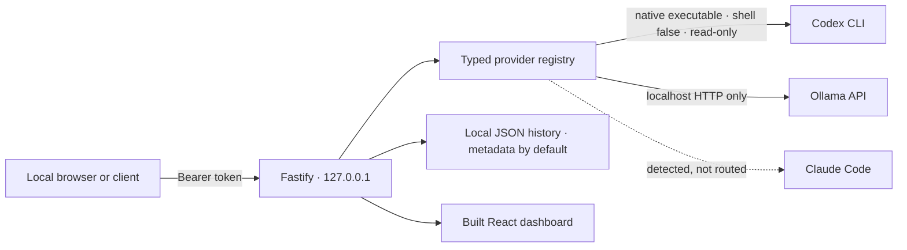

# SubBridge

SubBridge is a local-first AI gateway built with Node.js, TypeScript, Fastify, React, Vite, and Tailwind. Version 2 keeps the existing `POST /v1/chat/completions` contract and adds provider discovery, a local dashboard, Ollama support, streaming, and opt-in response history.

SubBridge implements a **small OpenAI-shaped subset**. It is not a drop-in OpenAI API replacement and does not claim full OpenAI compatibility.

## Architecture



The Codex adapter uses a fresh, empty working directory and a temporary isolated `CODEX_HOME` per request. It copies only the existing Codex `auth.json` into that temporary profile for the provider CLI to authenticate, then removes the whole temporary directory. MCP config, project instruction files, skills, plugins, shell profiles, and unrelated environment variables are not inherited. The CLI is run with `shell: false`, a read-only sandbox, and the shell, unified-exec, code-mode, and multi-agent features disabled with Codex's `--disable` flags. SubBridge never turns model output into a command.

## Requirements and setup

- Node.js 22.12 or newer (Node 22 is the primary tested runtime)
- npm
- Codex CLI logged in with `codex login` for Codex use, and/or Ollama running on localhost

Install dependencies once, then run the interactive wizard:

```sh
npm install
npm run setup
```

The wizard discovers native provider executables, recommends the loopback listener, generates a random gateway token, and writes local settings to `.env`. History is metadata-only unless you explicitly select full prompt/response history. The wizard prints the token once; the server also prints its configured local token when it starts. Keep both private.

Start development mode (API on `127.0.0.1:8787`, dashboard on `127.0.0.1:5173`):

```sh
npm run dev
```

Build the dashboard and server, then run the production-style local server (dashboard and API share port 8787):

```sh
npm run build
npm run start
```

Open [http://127.0.0.1:8787](http://127.0.0.1:8787) and paste the gateway token into the dashboard. The dashboard keeps the token in browser `sessionStorage` for the current tab only. No analytics, telemetry, or third-party dashboard requests are included.

## CLI examples

### PowerShell

```powershell
$env:SUBBRIDGE_TOKEN = "your-local-token"
npm run dev
```

### Git Bash

```bash
export SUBBRIDGE_TOKEN='your-local-token'
npm run dev
```

### macOS and Linux

```bash
export SUBBRIDGE_TOKEN='your-local-token'
npm run dev
```

The setup wizard can write `.env` so environment variables do not need to be re-entered for each shell session.

## Providers

| Provider | Detection and status | Adapter | Streaming | Model list |
| --- | --- | --- | --- | --- |
| Codex CLI | Searches `PATH` and known native install locations; verifies the native executable with a bounded `--version` call and uses `codex login status` for auth state. | Implemented | Yes, final-only SSE chunk | No reliable CLI catalog; enter a model ID supported by your Codex CLI/account. |
| Ollama | Verifies the executable when present and checks the loopback `/api/tags` endpoint. A reachable API can be detected even if the executable is not on `PATH`. | Implemented | Yes, actual NDJSON text deltas | Live list from Ollama `/api/tags`. |
| Claude Code | Detects and verifies a native CLI executable. | Not implemented; shown as unavailable | No | None. |

Claude Code being installed does not make it a SubBridge provider. There is no Claude adapter, and SubBridge does not proxy Claude subscription use. Any future Claude integration must follow Anthropic’s current API, licensing, and account policies. Provider subscriptions, rate limits, and authorization are not bypassed. Ollama must be installed and started separately; SubBridge only connects to a loopback URL (`OLLAMA_BASE_URL`, default `http://127.0.0.1:11434`).

Codex model choices and availability are controlled by the installed Codex CLI and the user’s account. Provider status checks use `codex login status`; they do not make an inference request. Auth checks only return a state and a safe explanation. Raw auth output and tokens are never returned or logged.

## API

`GET /health` preserves the V1 unauthenticated health check and returns `{"status":"ok"}`. All `/v1/*` API routes require `Authorization: Bearer <SUBBRIDGE_TOKEN>`.

For integration walkthroughs and complete JavaScript, Python, Next.js, FastAPI, curl, and chatbot examples, start at [docs/getting-started.md](docs/getting-started.md). The dashboard's Documentation page also includes a copyable SDK example.

```http
POST /v1/chat/completions
Authorization: Bearer your-local-token
Content-Type: application/json
```

```json
{
  "provider": "codex",
  "model": "gpt-6-luna",
  "messages": [{ "role": "user", "content": "Reply with exactly: SubBridge is ready" }],
  "stream": false
}
```

`provider` is optional and defaults to `codex`, preserving V1 calls. Roles supported are `system`, `developer`, `user`, and `assistant`; content must be text. `stream` defaults to `false`. Tool calls, images/audio, function calling, multiple choices, sampling controls, and complete OpenAI response semantics are not implemented. Provider usage is included only when the adapter reports it accurately; server and provider durations are exposed in `X-SubBridge-Request-Duration-Ms` and `X-SubBridge-Provider-Duration-Ms` headers. Missing usage is omitted.

The response keeps the minimal V1 form:

```json
{
  "id": "chatcmpl-…",
  "object": "chat.completion",
  "created": 1791707000,
  "model": "gpt-6-luna",
  "choices": [{ "index": 0, "message": { "role": "assistant", "content": "SubBridge is ready" }, "finish_reason": "stop" }]
}
```

`GET /v1/providers` returns verified installation, auth, capability, executable-path, version, and live Ollama model information. `GET /v1/providers/:id/status` returns current provider state. `GET /v1/models` returns provider-advertised model IDs in an OpenAI-shaped list, with an optional `?provider=ollama` filter. Results are briefly cached. Codex does not provide a documented model-catalog command in the inspected CLI, so its catalog is empty; explicit model IDs still work. States are `ready`, `not-installed`, `auth-required`, `unavailable`, `error`, and `unknown`.

`GET /v1/config` returns safe runtime settings and discovered executable paths without returning the gateway token. `GET /v1/history` returns local history. `DELETE /v1/history` clears it; `DELETE /v1/history/:id` removes one record. These routes require the gateway bearer token.

## Streaming

Set `"stream": true` to receive Server-Sent Events with OpenAI-shaped `chat.completion.chunk` frames and a final `data: [DONE]` marker. Ollama forwards text deltas from its NDJSON stream. Codex `exec --json` provides completed agent-message events rather than reliable token deltas in the supported CLI path; SubBridge ignores progress events and sends one final content chunk, then a finish chunk and `[DONE]`. It does not simulate token streaming. Disconnects and request timeouts abort the provider process or HTTP request. Partial JSONL lines are buffered before parsing.

## Curl examples

With the server running and `SUBBRIDGE_TOKEN` set:

### Git Bash, macOS, Linux

```bash
curl --fail-with-body http://127.0.0.1:8787/health
curl --fail-with-body http://127.0.0.1:8787/v1/providers \
  -H "Authorization: Bearer $SUBBRIDGE_TOKEN"
curl --fail-with-body http://127.0.0.1:8787/v1/chat/completions \
  -H "Authorization: Bearer $SUBBRIDGE_TOKEN" \
  -H 'Content-Type: application/json' \
  -d '{"model":"gpt-6-luna","messages":[{"role":"user","content":"Reply with exactly: SubBridge is ready"}]}'
```

### PowerShell

```powershell
curl.exe --fail-with-body http://127.0.0.1:8787/health
curl.exe --fail-with-body http://127.0.0.1:8787/v1/chat/completions -H "Authorization: Bearer $env:SUBBRIDGE_TOKEN" -H "Content-Type: application/json" -d '{"provider":"ollama","model":"your-installed-model","messages":[{"role":"user","content":"Say hello"}],"stream":false}'
```

For streaming, add `-N` to curl and set `"stream":true` in the JSON body.

## Client examples

### Node.js

```js
const response = await fetch("http://127.0.0.1:8787/v1/chat/completions", {
  method: "POST",
  headers: {
    authorization: `Bearer ${process.env.SUBBRIDGE_TOKEN}`,
    "content-type": "application/json",
  },
  body: JSON.stringify({
    provider: "ollama",
    model: "your-installed-model",
    messages: [{ role: "user", content: "Say hello" }],
  }),
});
if (!response.ok) throw new Error(await response.text());
console.log((await response.json()).choices[0].message.content);
```

### Python

```python
import json
import os
from urllib.request import Request, urlopen

request = Request(
    "http://127.0.0.1:8787/v1/chat/completions",
    data=json.dumps({
        "provider": "ollama",
        "model": "your-installed-model",
        "messages": [{"role": "user", "content": "Say hello"}],
    }).encode(),
    headers={
        "Authorization": f"Bearer {os.environ['SUBBRIDGE_TOKEN']}",
        "Content-Type": "application/json",
    },
)
with urlopen(request) as response:
    print(json.load(response)["choices"][0]["message"]["content"])
```

## Configuration

| Variable | Default | Purpose |
| --- | --- | --- |
| `SUBBRIDGE_HOST` | `127.0.0.1` | Bind address. Loopback by default. |
| `SUBBRIDGE_PORT` | `8787` | Local server port. |
| `SUBBRIDGE_TOKEN` | Random at startup | Local bearer token. The setup wizard persists one in ignored `.env`. |
| `SUBBRIDGE_REQUEST_TIMEOUT_MS` | `120000` | Timeout includes time waiting in the serialized provider queue. |
| `SUBBRIDGE_MAX_BODY_BYTES` | `1048576` | Request body limit. |
| `SUBBRIDGE_MAX_QUEUE` | `8` | Waiting provider requests before rejecting with 429. One provider request runs at a time. |
| `SUBBRIDGE_HISTORY_MODE` | `metadata` | `metadata` omits prompts/responses; `full` stores both locally. |
| `SUBBRIDGE_DATA_DIR` | OS application state directory | Override local JSON history location. |
| `CODEX_COMMAND` | Native `codex` found by discovery | Optional explicit path/name override. `.cmd` and `.ps1` are rejected on Windows. |
| `OLLAMA_BASE_URL` | `http://127.0.0.1:11434` | Loopback-only Ollama API URL. |
| `SUBBRIDGE_ALLOW_REMOTE` | unset | Must be `true` with a non-loopback `SUBBRIDGE_HOST`; remote use has no TLS and is not recommended. |

On Windows, SubBridge searches `PATH`, known app locations, and npm package vendor directories including `@openai/codex-win32-x64`. On macOS/Linux it checks `PATH`, common native install locations, and the platform Codex vendor directory. A candidate must be a native executable and return `--version` within a short timeout. It never launches `.cmd` or `.ps1` shims using a shell. If your install only exposes a shim, install/locate its native executable and point `CODEX_COMMAND` to that executable.

History is a bounded local JSON file (up to 500 records), with no credentials in it. The default metadata mode stores timestamp, provider, model, duration, and outcome only. Full mode also stores prompt and response. Delete individual records or clear all history from the dashboard or authenticated API. Files are written with owner-only permissions where the platform supports them.

## Security model

- Listener defaults to IPv4 loopback. Remote binding requires an explicit environment switch and still requires the gateway bearer token; SubBridge does not add TLS.
- `/v1/*` routes require bearer auth. `/health` is deliberately unauthenticated to preserve V1 behavior and contains only a status value.
- Host and Origin checks reject non-local hosts, DNS-rebinding hostnames, and cross-origin browser requests. There is no permissive CORS policy. Vite development proxy is limited to loopback.
- A small in-memory request-rate limit and bounded serialized queue limit local resource use.
- Only validated model identifiers and known provider IDs reach adapters. HTTP input cannot select executable paths or commands.
- Codex is launched as a direct native process with `shell: false`, sanitized environment, isolated temporary home/workspace, read-only sandbox, bounded output, disabled shell/code/multi-agent tools, timeout, and cleanup.
- Ollama requests go only to an HTTP loopback URL. Claude is detection-only. No adapter bypasses provider licensing, subscription restrictions, authentication, or rate limits.
- The dashboard token is kept in the current tab’s `sessionStorage`; history never stores the token or provider credentials. Do not enable full history if prompts or answers contain sensitive information.
- No telemetry or third-party scripts are used.

## Troubleshooting

- **Dashboard says it cannot connect:** confirm `npm run dev` or `npm run start` is running and paste the token from setup/server output. The dashboard token is tab-scoped.
- **Codex is unavailable:** check that a native executable is on `PATH`, `CODEX_COMMAND` points to it, and `codex login status` reports a session. On Windows, do not point to `codex.cmd`.
- **Codex model rejected:** enter a model ID supported by your CLI version and account. Status checks do not run a model call.
- **Ollama unavailable:** start Ollama locally, confirm `http://127.0.0.1:11434/api/tags` responds, and use an installed model name from `/v1/providers` or `ollama list`.
- **No streaming from Codex:** expected for the currently supported JSONL events; SubBridge emits one final text chunk rather than pretending to stream tokens.
- **Claude detected but unavailable:** SubBridge has no Claude adapter. Do not route a Claude subscription through a generic proxy; use only an integration explicitly authorized by the provider.

## Development and verification

```sh
npm run build
npm test
```

The tests cover REST auth and V1 response shape, host rebinding checks, SSE framing/chunk assembly, provider state mapping, executable verification, Windows shim rejection/vendor-path discovery, Ollama URL safety, and history privacy/deletion. End-to-end provider calls require a separately installed and authorized Codex CLI or running Ollama instance.
